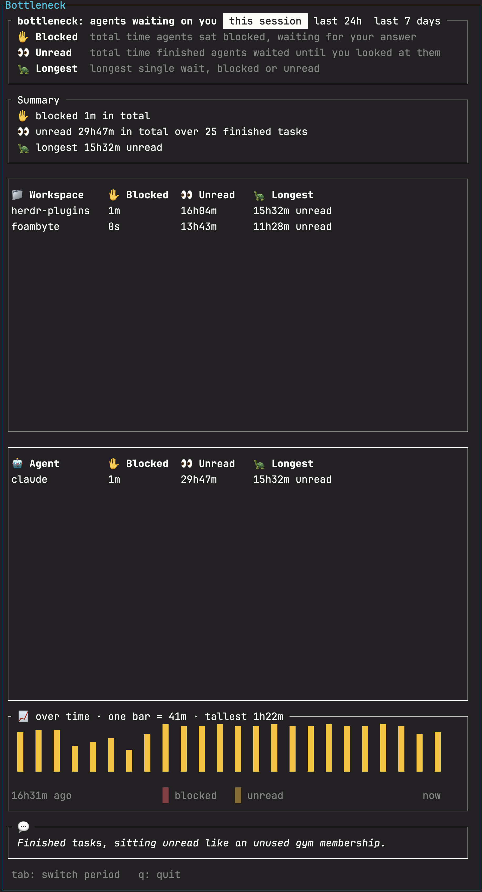

# bottleneck

A [Herdr](https://herdr.dev) plugin that measures how long your AI coding
agents sit waiting on you.

Running several agents in parallel moves the bottleneck from the agents to
the human. An agent blocked on a permission prompt, or finished and waiting
for review, does nothing until you get to it. bottleneck records every agent
state change and shows where that waiting time goes, so you can see it and
cut it down.


<!-- TODO: add a screenshot of the report pane -->

## What it measures

Per workspace and per agent, for the current Herdr session, the last 24
hours or the last 7 days:

| Column | Meaning |
|---|---|
| ✋ Blocked | total time agents sat `blocked`, waiting for your answer |
| 👀 Unread | total time finished agents waited until you looked at them |
| 🐢 Longest | longest single wait, blocked or unread |

Herdr reports `blocked` only when an agent stops to ask you something, such
as a permission prompt. If your agents auto-approve their tools, most of
their waiting shows up as 👀 Unread instead. That wait ends when the agent
leaves `done`, which Herdr defines as "idle and not yet seen".

The report ends with a joke aimed at whichever wait cost you more in total,
blocked or unread.

It also publishes each pane's blocked time over the last 24 hours as a
`$waited` token (for example `waited 14m`) that you can show in Herdr's agent
sidebar.

## Install

Requires Herdr 0.9.3 or later and a Rust toolchain (`cargo`, Rust 1.85+):
Herdr builds the plugin from source at install time.

```sh
herdr plugin install rsdlt/bottleneck
```

Then bind a key to the report in `~/.config/herdr/config.toml`:

```toml
[[keys.command]]
key = "prefix+b"
type = "plugin_action"
command = "rsdlt.bottleneck.open-report"
description = "Bottleneck report"
```

Optionally, show the token in the agent sidebar:

```toml
[ui.sidebar.agents]
rows = [
  ["state_icon", "machine", "workspace", "tab"],
  ["agent", "$waited"],
]
```

In the report, `Tab` cycles through this session, the last 24 hours and the
last 7 days, and `q` or `Esc` closes it. "This session" starts at the last
Herdr restart; until Herdr restarts after you install the plugin, it covers
everything recorded so far.

## How it works

```
Herdr ──event hook──▶ bottleneck record ──append──▶ $HERDR_PLUGIN_STATE_DIR/events.jsonl
                              └──▶ herdr pane report-metadata … --token waited=…
key ──▶ action ──▶ popup ──▶ bottleneck view ──read──▶ events.jsonl
```

- **Recording.** Herdr runs `bottleneck record` as an `[[events]]` hook on
  `pane.agent_status_changed`, `pane.closed` and `pane.exited`. Each run
  appends one JSON line and exits; there is no background process. Herdr
  payloads have no timestamp, so each line is stamped when its hook starts.
- **Reporting.** `bottleneck view` reads the log every two seconds. All the
  arithmetic lives in [`src/stats.rs`](src/stats.rs), a pure module with no
  I/O or clock, so every rule below has a unit test.

Rules for edge cases:

- **`unknown` is ignored.** Herdr briefly reports `unknown` between real
  states. If it ended a wait, waits would be cut short.
- **Out-of-order lines are expected.** Hooks run concurrently, so the log is
  replayed in timestamp order, not file order.
- **A pane closed while blocked** still counts, and is flagged *abandoned*.
- **A Herdr restart** (recorded by a `[[startup]]` hook) ends any open wait
  at an unknown time. Those waits are shown as interrupted and not counted,
  so they can't inflate the numbers.
- **Corrupt log lines** are skipped, counted and shown in the report.

All data stays local in `HERDR_PLUGIN_STATE_DIR`.

## Limitations

- The log is never pruned. It grows by one short line per state change.
- The 24-hour and 7-day windows are rolling, not calendar days.
- Linux and macOS only for now.

## Development

```sh
cargo build --release
herdr plugin link .        # link does not run the build step
cargo test
cargo clippy --all-targets -- -D warnings
```

## License

[Apache-2.0](LICENSE), the same as Herdr.
